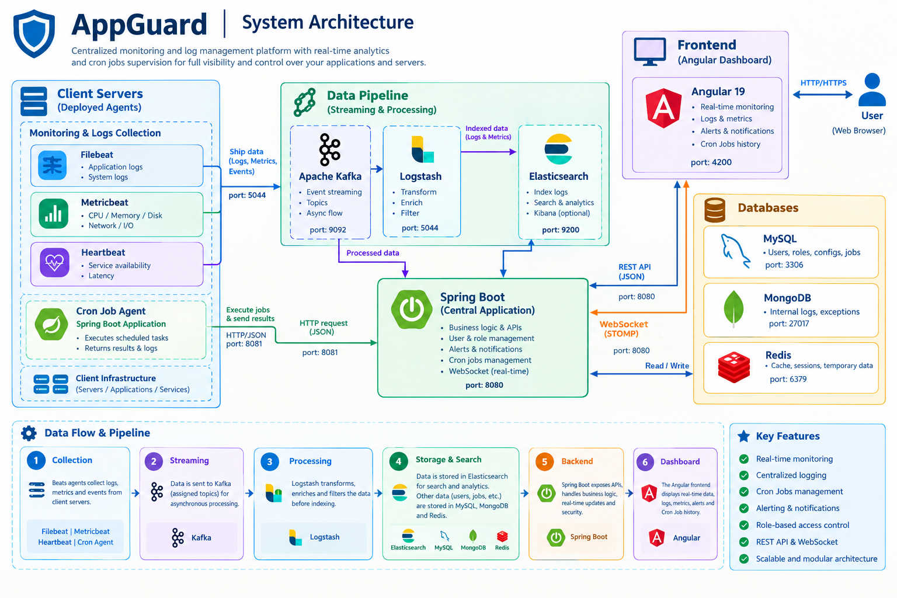

<h1 align="center">🛡️ AppGuard</h1>

<p align="center"><b>Real-time application and infrastructure supervision, from discovery to action.</b></p>

<p align="center">
  
  
  
  
  
  
  
  
  
</p>

<p align="center">
  
</p>

<p align="center">
  <a href="#-why-appguard">Why AppGuard</a> ·
  <a href="#-event-pipeline">Event pipeline</a> ·
  <a href="#-cron-job-management-and-resilience">Cron jobs</a> ·
  <a href="#-main-components">Components</a> ·
  <a href="#-technology">Technology</a> ·
  <a href="#-getting-started">Getting started</a> ·
  <a href="#-repository-layout">Layout</a>
</p>

---

AppGuard helps operations teams understand what is running across client environments, detect changes as telemetry arrives, follow platform health, and manage scheduled maintenance tasks from one dashboard.

> 🏢 **Context:** AppGuard was developed as an end-of-studies project (PFE) at **SFM Technologies** (Tunis, February - July 2025), as part of the Software Engineering degree at ENICarthage.

## 💡 Why AppGuard

- 🔍 **Automatic discovery:** incoming telemetry can reveal previously unknown applications, servers, and services. AppGuard registers discoveries and can notify the team, reducing the need to maintain every inventory entry by hand.
- ⚡ **Kafka-first event pipeline:** the central Spring Boot application consumes log and metric events directly from Kafka. This event-driven path avoids waiting for a polling cycle to begin processing new telemetry and supports responsive monitoring.
- 📡 **Live visibility:** processed logs, metrics, and alerts are pushed to the Angular dashboard over WebSockets, so operators can follow changes as they happen.
- ❤️ **Continuous supervision:** scheduled health checks track server availability and service status. Status changes and detected issues can be surfaced as alerts.
- 🧾 **Useful incident context:** application logs are searchable, API errors receive consistent responses, and scheduled-job executions retain their result, output, duration, and failure details for review.
- 🤖 **Operational automation:** Quartz schedules jobs in the central backend and dispatches them to the cron agent on the target server. Execution history and alerts help operators see whether a task completed or failed.
- 👥 **Team and client organization:** users, roles, clients, servers, and applications are managed in one place, alongside dashboards and reports.

## 🔄 Event pipeline

<p align="center">
  
</p>

Kafka listeners in the central application consume the `app-logs`, `system-metrics`, and `new-service-metrics` streams. The backend performs quick checks on incoming events, uses Redis to avoid repeatedly processing known entities and queue discovery work, then processes pending discoveries in batches. Relevant updates are persisted and sent to dashboard subscribers.

This keeps telemetry handling event-driven: the central application receives events from Kafka directly instead of waiting for a separate polling service to fetch them.

## ⏱️ Cron job management and resilience

AppGuard centralizes recurring operational tasks rather than requiring operators to manage schedules independently on every server. A job is associated with a target server and includes a command, a Quartz cron expression, a timeout, and a configurable retry count. Quartz validates and schedules the recurring job in the backend; when it is due, the backend sends an authenticated request to that server's cron agent.

The agent runs the requested command and returns structured execution details. AppGuard can retain the result, exit code, standard output, error output, and duration in the execution history, giving operators context to investigate failures. Jobs can also be paused while a server is in maintenance and reactivated when it returns to service. Repeated agent communication failures can trigger an `AGENT_UNREACHABLE` alert for operators.

**How the retry count works:** the job's `retryCount` represents retries after the initial attempt. For example, a retry count of `2` means up to **3 total attempts** (one initial attempt plus two retries); `0` means no retries. Newly created jobs default to one retry when no non-negative retry count is supplied. The current request loop retries HTTP client/server errors; it does not retry a command merely because the agent successfully returned a non-zero command exit code. A timeout is sent to the agent, but the agent currently enforces its own 60-second execution timeout.

When the retry loop exhausts its attempts, the backend records an agent-unreachable failure and raises an alert, rather than silently discarding the failure. The service also declares a Resilience4j circuit-breaker fallback; however, the annotated method is private and invoked internally, so Spring's proxy-based resilience annotation may not be applied in the current implementation. These mechanisms do not guarantee command delivery or exactly-once execution: a network failure after a command starts can make its outcome uncertain. Design scheduled commands to be safe to run more than once, and verify their effects where possible.

> [!NOTE]
> **Implementation note:** retry/backoff behavior depends on the HTTP error type and current service implementation. The configured retry count is applied by the explicit request loop; do not assume a five-second delay between attempts or retries for every possible network exception without validating the implementation for your deployment.

## 🧩 Main components

| Component | Location | Responsibility |
| --- | --- | --- |
| AppGuard API | `backend/appguard-api` | REST API, authentication, inventory, event consumers, alerts, dashboards, reports, and job scheduling |
| Cron agent | `backend/agent-cron` | Authenticated execution endpoint deployed on a target server; runs scheduled commands and returns execution details |
| Web dashboard | `frontend/appguard-web` | Angular interface for monitoring and managing the platform |

## 🛠️ Technology

- **Frontend:** Angular, TypeScript, Angular Material, Chart.js, and STOMP/WebSockets
- **Backend:** Java 17 and Spring Boot
- **Event processing:** Apache Kafka
- **Scheduling and caching:** Quartz and Redis
- **Data services:** MySQL, MongoDB, and Elasticsearch

## 🚀 Getting started

You need Java 17, Node.js with npm, and the backing services configured for your environment. See [backend configuration](backend/appguard-api/SECURITY_CONFIGURATION.md) for required environment variables and local setup notes. Do not commit real credentials or API keys.

Start the main API:

```sh
cd backend/appguard-api
./mvnw spring-boot:run
```

Start the cron agent on a trusted target server. Set `AGENT_API_KEY` to the key assigned to that server in AppGuard before starting it:

```sh
cd backend/agent-cron
./mvnw spring-boot:run
```

Start the Angular dashboard:

```sh
cd frontend/appguard-web
npm ci
npm start
```

The Angular development server is available at `http://localhost:4200` by default. The API uses the configured application port (8081 by default).

> [!WARNING]
> **Security:** the cron agent executes shell commands on its host. Deploy it only on systems you administer, protect its API key, and allow only trusted users to manage scheduled commands.

## 🗂️ Repository layout

```text
AppGuard/
├── backend/
│   ├── appguard-api/
│   └── agent-cron/
├── frontend/
│   └── appguard-web/
├── .gitignore
└── README.md
```

---

<p align="center">
  Built by <b>Hanen Khmilet</b> (<a href="https://github.com/hanen-kh">@hanen-kh</a>) · End-of-studies project at <b>SFM Technologies</b> · ENICarthage, 2025
</p>
